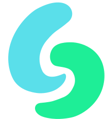
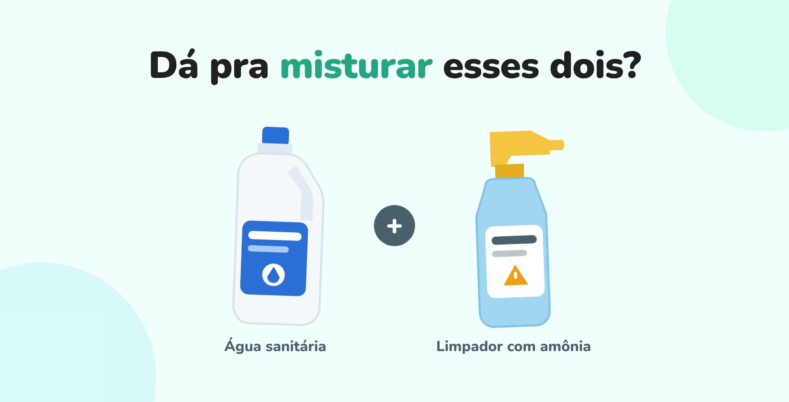
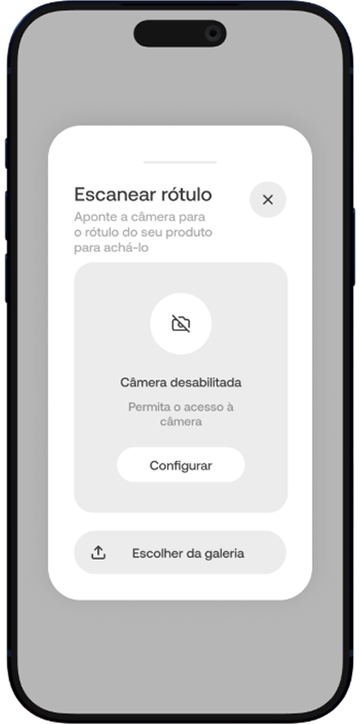
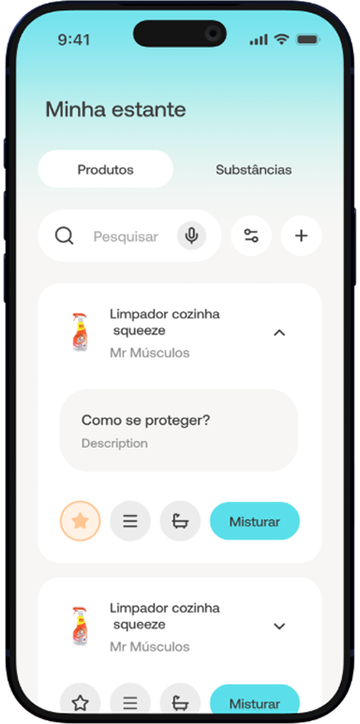
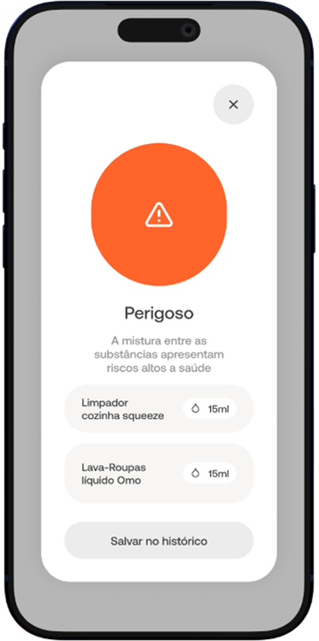
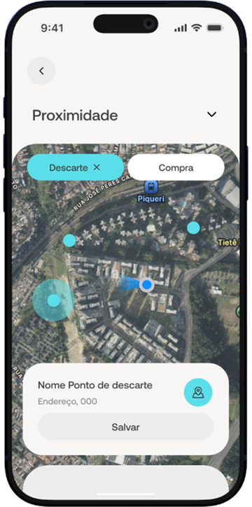
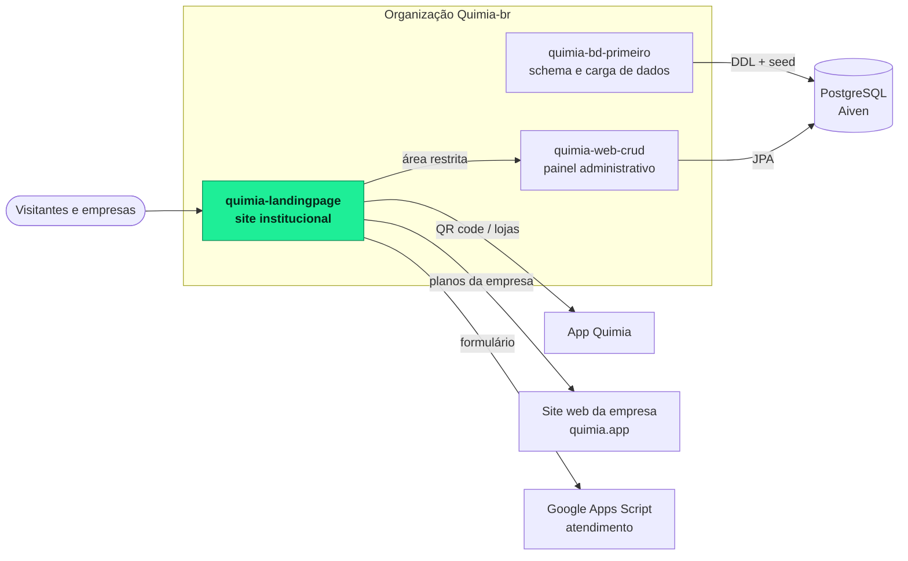
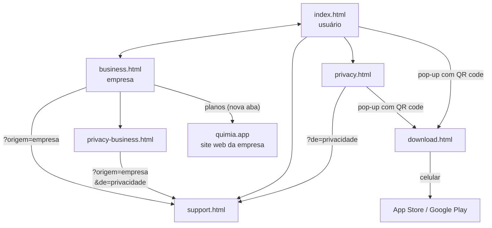
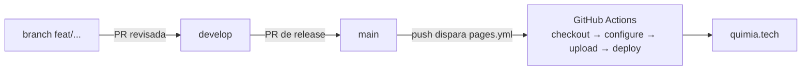
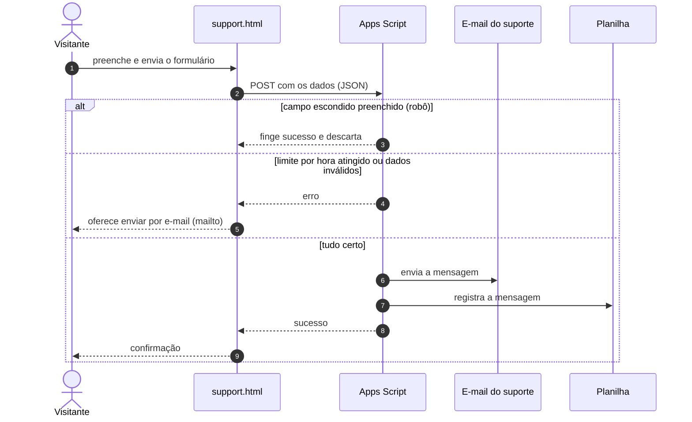

<a id="top"></a>

<div align="center">



# Quimia · Site

**Site institucional do Quimia, o app que ajuda a evitar misturas perigosas de produtos de limpeza.**

<a href="https://quimia.tech"></a>

[](https://developer.mozilla.org/docs/Web/HTML)
[](https://developer.mozilla.org/docs/Web/CSS)
[](https://developer.mozilla.org/docs/Web/JavaScript)
[](https://developers.google.com/apps-script)
[](https://pages.github.com/)
[](#como-rodar-localmente)

[](https://github.com/Quimia-br/quimia-landingpage/actions/workflows/pages.yml)
[&style=flat-square)](https://github.com/Quimia-br/quimia-landingpage/commits/develop)
[](LICENSE)
[](https://github.com/Quimia-br/quimia-landingpage)

[Páginas](#páginas) ·
[Rodar localmente](#como-rodar-localmente) ·
[Publicação](#publicação-github-pages) ·
[Atendimento](#serviço-de-atendimento) ·
[Contribuindo](#contribuindo)

<br>



</div>

---

## Sumário

- [Sobre](#sobre)
- [O app em quatro telas](#o-app-em-quatro-telas)
- [O ecossistema Quimia](#o-ecossistema-quimia)
- [Páginas](#páginas)
- [Destaques técnicos](#destaques-técnicos)
- [Como rodar localmente](#como-rodar-localmente)
- [Estrutura de pastas](#estrutura-de-pastas)
- [Publicação (GitHub Pages)](#publicação-github-pages)
- [Serviço de atendimento](#serviço-de-atendimento)
- [Configurações que dependem da equipe](#configurações-que-dependem-da-equipe)
- [Contribuindo](#contribuindo)
- [Equipe](#equipe)
- [Licença](#licença)

## Sobre

Este repositório reúne todo o site público do **Quimia**: duas landing pages (uma para quem usa o app e outra para as empresas parceiras), a página de atendimento ao cliente, as declarações de privacidade e a página de download do app, que é o destino do QR code.

É um site estático em **HTML, CSS e JavaScript puros**. Não há etapa de build, framework ou dependência para instalar, e o site está publicado em **[quimia.tech](https://quimia.tech)**.

<p align="right"><a href="#top">voltar ao topo</a></p>

## O app em quatro telas

<div align="center">

| Escanear | Estante | Misturas | Proximidades |
|:---:|:---:|:---:|:---:|
|  |  |  |  |
| Encontra o produto pelo rótulo | Organiza os produtos da casa | Avisa quando uma mistura é perigosa | Mostra pontos de descarte e compra |

</div>

<p align="right"><a href="#top">voltar ao topo</a></p>

## O ecossistema Quimia



<p align="right"><a href="#top">voltar ao topo</a></p>

## Páginas

| Página | Arquivo | Para quê |
|---|---|---|
| Landing do usuário | [`index.html`](site/index.html) | Apresenta o app, os recursos e o vídeo de demonstração |
| Landing da empresa | [`business.html`](site/business.html) | Apresenta os dashboards, os planos e a privacidade dos dados |
| Atendimento ao cliente | [`support.html`](site/support.html) | Formulário de contato (aceita `?origem=empresa` e `?de=privacidade`) |
| Privacidade do usuário | [`privacy.html`](site/privacy.html) | Declaração de Privacidade para quem usa o app |
| Privacidade da empresa | [`privacy-business.html`](site/privacy-business.html) | Declaração de Privacidade para empresas |
| Download do app | [`download.html`](site/download.html) | Destino do QR code: no celular vai direto para a loja, no computador mostra as lojas |



<p align="right"><a href="#top">voltar ao topo</a></p>

## Destaques técnicos

| Recurso | Onde |
|---|---|
| **Responsivo de 360 a 1440 px**, com carrosséis que deslizam com o dedo no celular (recursos do app e planos da empresa) | `css/user.css`, `css/business.css`, `js/user.js`, `js/business.js` |
| **Vídeo de demonstração com legendas** em WebVTT, versão para celular e para desktop, e botão para ativar o som | `assets/user/videos/`, `index.html` |
| **Acessibilidade**: rótulos `aria-*`, botões com estado (`aria-pressed`) e respeito ao `prefers-reduced-motion` | todas as páginas |
| **Detecção de celular** (iOS e Android, incluindo iPad) para mandar direto à loja certa | `js/store-links.js` |
| **QR code gerado no navegador** com `qrcodejs` | `js/download-modal.js` |
| **Privacidade com temas claro e escuro** e índice que acompanha a rolagem (`IntersectionObserver`, sem bibliotecas) | `css/privacy.css`, `js/privacy.js` |
| **Formulário com proteção anti-spam** (campo escondido e limite por hora) e alternativa por e-mail se o serviço falhar | `js/support.js`, `apps-script/Code.gs` |
| **Caminhos relativos** em todo o site, que funciona tanto em `github.io` quanto em domínio próprio | todo o site |

<p align="right"><a href="#top">voltar ao topo</a></p>

## Como rodar localmente

Sirva a pasta `site/` com qualquer servidor estático:

<table>
<tr><th>Python</th><th>Node.js</th><th>VS Code</th></tr>
<tr>
<td>

```bash
cd site
python -m http.server 8000
```

</td>
<td>

```bash
npx serve site
```

</td>
<td>

Extensão **Live Server**, com a pasta `site/` aberta

</td>
</tr>
</table>

Depois abra <http://localhost:8000> (ou o endereço que o servidor mostrar).

> [!WARNING]
> Evite abrir os arquivos direto pelo navegador (`file://`): alguns recursos, como as legendas do vídeo, só funcionam via servidor.

<p align="right"><a href="#top">voltar ao topo</a></p>

## Estrutura de pastas

O site publicável fica dentro de `site/`, que é a raiz do site.

<details>
<summary><b>Ver a árvore completa</b></summary>

<br>

```
site/
├── index.html                 Landing do usuário
├── business.html              Landing da empresa
├── support.html               Atendimento ao cliente
├── privacy.html               Privacidade (usuário)
├── privacy-business.html      Privacidade (empresa)
├── download.html              Página de download
│
├── css/                       Um arquivo de estilos por página
│   ├── user.css               Landing do usuário (também usado por download.html)
│   ├── business.css           Landing da empresa
│   ├── support.css            Atendimento
│   ├── privacy.css            Privacidade, com temas claro e escuro
│   └── download-modal.css     Pop-up de download usado na privacidade do usuário
│
├── js/                        Um arquivo de script por página, mais os compartilhados
│   ├── user.js                Landing do usuário
│   ├── business.js            Landing da empresa
│   ├── support.js             Formulário de atendimento
│   ├── privacy.js             Índice das páginas de privacidade
│   ├── download-modal.js      Pop-up de download (landing e privacidade do usuário)
│   └── store-links.js         Links das lojas e detecção de celular
│
└── assets/                    Mídia, separada por público
    ├── user/                  icons/, images/ e videos/
    ├── business/              icons/ e images/
    └── support/               icons/ e images/

apps-script/
└── Code.gs                    Serviço de atendimento (não vai para o site publicado)

.github/workflows/
└── pages.yml                  Publicação no GitHub Pages
```

</details>

### Convenções

- **Nomes de arquivos:** minúsculas, com hífen e sem espaços ou acentos (`background-tela-inicial.jpg`).
- **Um CSS e um JS por página.** O que é usado por mais de uma página fica em um arquivo próprio e compartilhado (`store-links.js`, `download-modal.js`).
- **Mídia por público.** Cada landing tem a sua pasta em `assets/`, para ficar claro o que pertence a cada uma.
- **Caminhos nos CSS** são relativos à pasta `css/` (por exemplo `../assets/user/images/capa.jpg`). Caminhos nos JS e nos HTML são relativos à raiz do site.
- **Cores, fontes e espaçamentos** ficam como variáveis CSS no início de cada arquivo de estilos.
- **Fontes:** Nunito, PT Sans e Reem Kufi, hospedadas em `assets/fonts/` (woff2, licença OFL) e declaradas com `@font-face` no começo de cada CSS.
- **Formatação:** o [`.editorconfig`](.editorconfig) define UTF-8, LF, 2 espaços e linha final em branco.

<details>
<summary><b>Paleta da marca</b></summary>

<br>

| Cor | Hex | Uso |
|---|---|---|
|  | `#1EEE97` | Verde do logo (início do degradê) |
|  | `#5ADFEA` | Ciano do logo (fim do degradê) |
|  | `#388AC9` | Item ativo da navegação |
|  | `#212121` | Títulos |
|  | `#E1F1EE` | Superfícies em verde-menta |

</details>

<p align="right"><a href="#top">voltar ao topo</a></p>

## Publicação (GitHub Pages)

O workflow [`pages.yml`](.github/workflows/pages.yml) publica a pasta `site/` sempre que a `main` recebe um merge. Também dá para rodá-lo à mão pela aba *Actions* (*Run workflow*).



<details>
<summary><b>Configuração única (para quem administra o repositório)</b></summary>

<br>

1. Em *Settings → Pages → Build and deployment → Source*, escolher **GitHub Actions**.
2. Em *Settings → Pages → Custom domain*, informar `quimia.tech` e, quando o certificado for emitido, marcar *Enforce HTTPS*.
3. No DNS do domínio, criar os registros indicados na [documentação do GitHub Pages](https://docs.github.com/pages/configuring-a-custom-domain-for-your-github-pages-site).

O endereço padrão (`quimia-br.github.io/quimia-landingpage/`) redireciona para o domínio próprio.

</details>

> [!IMPORTANT]
> O QR code do app aponta para `https://quimia.tech/download`, então esse endereço precisa continuar abrindo o `download.html`.

<p align="right"><a href="#top">voltar ao topo</a></p>

## Serviço de atendimento

O formulário de `support.html` envia as mensagens para um serviço próprio no **Google Apps Script** ([`apps-script/Code.gs`](apps-script/Code.gs)), que manda o e-mail para o suporte e registra a mensagem numa planilha.



<details>
<summary><b>Como publicar ou atualizar o serviço</b></summary>

<br>

1. Na planilha de atendimento da conta do suporte, abra *Extensões → Apps Script* e cole o `Code.gs`.
2. *Implantar → Nova implantação → App da Web*, com *Executar como: Eu* e *Quem pode acessar: Qualquer pessoa*.
3. Copie o endereço gerado (termina em `/exec`) para a constante `SUPPORT_ENDPOINT` em `js/support.js`.

Depois de mudar o código, é preciso criar uma nova versão da implantação.

</details>

<p align="right"><a href="#top">voltar ao topo</a></p>

## Configurações que dependem da equipe

- [ ] **Links das lojas** (App Store e Google Play) em `js/store-links.js`: hoje apontam para um app de exemplo.
- [ ] **Botão de download do vídeo** em `index.html`: o `href` ainda é `#` (há um `TODO` no código).
- [ ] **Texto das Declarações de Privacidade** (`privacy.html` e `privacy-business.html`): o conteúdo veio do design e precisa ser revisado por quem responde pelo jurídico.
- [ ] **Prazo de resposta do atendimento** em `support.html` e `js/support.js`: hoje diz "até 15 dias".
- [x] **Domínio próprio** `quimia.tech` configurado no GitHub Pages.
- [x] **Serviço de atendimento** publicado no Google Apps Script, com alternativa por e-mail.

Serviço de terceiros usado: Google Apps Script. As fontes e o `qrcode.min.js` ficam no próprio repositório.

<p align="right"><a href="#top">voltar ao topo</a></p>

## Contribuindo

1. Parta da `develop` atualizada e crie uma branch com prefixo do tipo: `feat/`, `fix/`, `style/`, `refactor/`, `chore/`.
2. Escreva os commits em inglês, no padrão [Conventional Commits](https://www.conventionalcommits.org/) e no imperativo, por exemplo `feat(support): add e-mail fallback`.
3. Abra a PR para a `develop` e peça a revisão de alguém da equipe.

> [!TIP]
> Antes de abrir a PR, confira as páginas de 360 a 1440 px (celular, tablet e desktop). Tablets grandes em pé costumam ser o caso mais difícil. No navegador, <kbd>F12</kbd> e depois <kbd>Ctrl</kbd> + <kbd>Shift</kbd> + <kbd>M</kbd> abre o modo de dispositivo.

<p align="right"><a href="#top">voltar ao topo</a></p>

## Equipe

<a href="https://github.com/Quimia-br/quimia-landingpage/graphs/contributors">
  
</a>

Projeto desenvolvido para a **ExpoTech 2026**.

| Repositório | Papel |
|---|---|
| [`quimia-web-crud`](https://github.com/Quimia-br/quimia-web-crud) | Painel administrativo (Spring Boot) |
| [`quimia-bd-primeiro`](https://github.com/Quimia-br/quimia-bd-primeiro) | Schema do PostgreSQL e carga de dados (seed) |

## Licença

Distribuído sob a licença MIT. Veja o arquivo [`LICENSE`](LICENSE).

<p align="right"><a href="#top">voltar ao topo</a></p>
